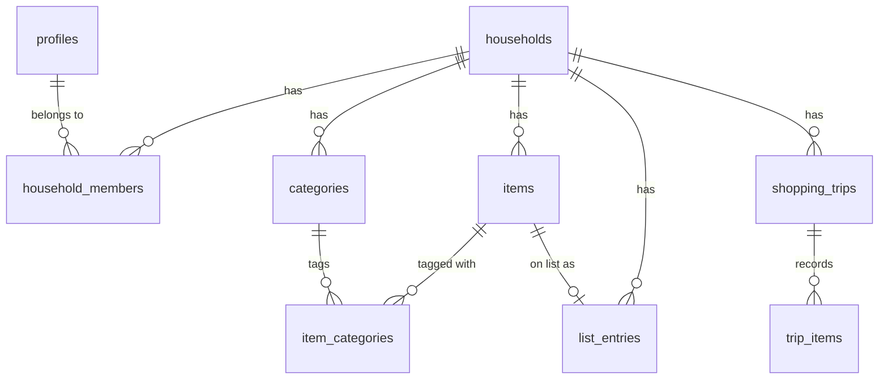

# Data model (MVP)

Derived from the clickable mockup in [mockups/index.html](./mockups/index.html).
Postgres (Supabase) shapes are shown here, but the core works with the TypeScript types below; only the Supabase adapter knows about tables.

## Diagram



## Tables

All ids are UUIDs **generated on the client**, so things created offline (a trip, for instance) already have their final id before they reach the server.
Every table that belongs to a household carries `household_id`, even where it could be derived. That keeps access rules to one check and lets live-update subscriptions filter by household.

### `profiles`

| column | type | notes |
|---|---|---|
| `user_id` | uuid PK | references `auth.users` |
| `display_name` | text | "Doug". The list shows its first letter as "added by" |

### `households`

| column | type | notes |
|---|---|---|
| `id` | uuid PK | |
| `name` | text | "Home" |
| `created_at` | timestamptz | |

### `household_members`

| column | type | notes |
|---|---|---|
| `household_id` | uuid FK | PK with `user_id` |
| `user_id` | uuid FK | |
| `created_at` | timestamptz | The app opens the user's earliest household |

### `categories`

| column | type | notes |
|---|---|---|
| `id` | uuid PK | |
| `household_id` | uuid FK | |
| `name` | text | unique per household |
| `position` | int | one fixed order for MVP, set by hand in the seed to match our usual store. It sets the order groups appear in on the list and shopping screens |

### `items` (the catalog)

| column | type | notes |
|---|---|---|
| `id` | uuid PK | |
| `household_id` | uuid FK | |
| `name` | text | unique per household, ignoring case, so "milk" and "Milk" can't both exist |
| `created_at`, `updated_at` | timestamptz | |

### `item_categories`

| column | type | notes |
|---|---|---|
| `item_id` | uuid FK | PK with `category_id`. Deleting the item deletes these rows |
| `category_id` | uuid FK | Deleting the category deletes these rows |
| `household_id` | uuid FK | duplicated from the item for access rules and live updates |
| `position` | int | 0 = primary category, the one the list groups by |

### `list_entries`

| column | type | notes |
|---|---|---|
| `id` | uuid PK | |
| `household_id` | uuid FK | |
| `item_id` | uuid FK | **unique**: an item is on the list at most once. Deleting the item deletes its entry |
| `note` | text null | "2 gallons", "the good kind" |
| `status` | `'needed' \| 'in_cart'` | |
| `added_by` | uuid FK → profiles | |
| `created_at`, `updated_at` | timestamptz | `updated_at` decides which offline change wins |

### `shopping_trips`

| column | type | notes |
|---|---|---|
| `id` | uuid PK | |
| `household_id` | uuid FK | |
| `started_by` | uuid FK → profiles | shown as "Doug is shopping" |
| `started_at` | timestamptz | |
| `completed_at` | timestamptz null | null = in progress. **Partial unique index**: at most one trip in progress per household |

### `trip_items`

| column | type | notes |
|---|---|---|
| `trip_id` | uuid FK | |
| `item_id` | uuid FK null | set to null if the item is later deleted |
| `name` | text | copy of the item name at checkout, so the record still reads correctly after renames or deletes |
| `note` | text null | copy of the note |
| `outcome` | `'bought' \| 'left'` | `left` = not found and kept on the list. This powers the trip summary |

There's no history screen yet, but recording trips now means history (and later, store routing) needs no change to the data.

## Core types (sketch)

```ts
type EntryStatus = 'needed' | 'in_cart';

type ListEntry = {
  id: EntryId; itemId: ItemId; note: string | null;
  status: EntryStatus; addedBy: UserId; updatedAt: Instant;
};

// The household's current mode, derived from whether a trip is in progress.
type ShopState =
  | { kind: 'planning' }
  | { kind: 'shopping'; trip: { id: TripId; startedBy: UserId; startedAt: Instant } };

// Changes that may be made offline: these wait in a queue saved on the phone and replay in order.
type PendingOp =
  | { kind: 'startTrip'; tripId: TripId; startedAt: Instant }
  | { kind: 'setEntryStatus'; entryId: EntryId; status: EntryStatus; at: Instant }
  | { kind: 'completeTrip'; tripId: TripId; completedAt: Instant;
      bought: EntryId[]; left: EntryId[] };
```

Ids are branded strings (`string & { __brand: 'ItemId' }`) so they can't be mixed up.

## Offline sync rules

1. **Ops set a value, they don't flip it.** "Set Milk to in_cart at 10:42", never "toggle Milk". Replaying an op twice is harmless.
2. **The latest change wins.** The server applies `setEntryStatus` only if `at` is newer than the entry's `updated_at`.
3. **Completing a trip is one server function** (`complete_trip`), run in a single transaction:
   1. Write the `trip_items` rows.
   2. Delete only the entries listed in `bought`.
   3. Set `completed_at`.

   Anything the other person added while the trip was underway is untouched because it isn't in `bought`.
4. **Missing rows are skipped, not errors.** If an entry was removed by the other person before the queue replays, that op is dropped.
5. **Starting a trip when one is already in progress is rejected** by the unique index. Since only one person shops at a time, the app just shows the trip already underway.

## Access rules

One Postgres function, `is_member(household_id)`, which checks `household_members` for the signed-in user. Every table's rules call it for select, insert, update and delete. Sign-ups are disabled and the seed script creates the two accounts, the "Home" household and the default categories.

## Live updates

The app subscribes, filtered by `household_id`, to changes on:
- `list_entries`
- `shopping_trips`
- `items`
- `item_categories`
- `categories`

## Screen → data

| Mockup screen | Reads | Writes |
|---|---|---|
| Sign in | auth, `profiles`, first `household_members` row | none |
| List | `list_entries` + `items` + primary `item_categories`/`categories`, the trip in progress | add/remove entry, edit note, create item |
| Quick-add search | `items` (by name) | new `items` + `item_categories` + `list_entries` |
| Catalog | `items`, `item_categories`, `categories`, `list_entries` (to show "On list") | edit/delete item, set categories, add/remove from list |
| Shopping | `list_entries`, trip in progress | `startTrip`, `setEntryStatus`, `completeTrip` (all work offline) |
| Trip summary | the just-completed trip's `trip_items` (kept locally) | none |

## Later, not MVP

- **Category order per store**: new `stores (id, household_id, name)` and `store_category_order (store_id, category_id, position)` tables. When a store is chosen, its order replaces `categories.position`, which stays as the default.
- **Item location per store**: `item_store_locations (store_id, item_id, aisle, position)`. `items` stays as it is. The shopping screen sorts by item location when one exists, then by the store's category order, then by the default order.
- **Household picker** for people in more than one household. The tables already support it.
- **Trip history screen**: reads `shopping_trips` + `trip_items`.
- **Editable/reorderable categories**: `categories.position` already exists.
